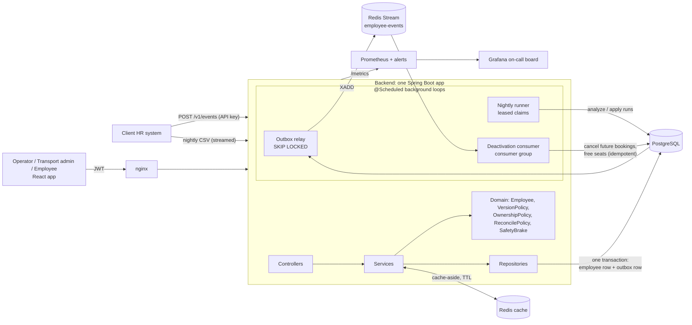
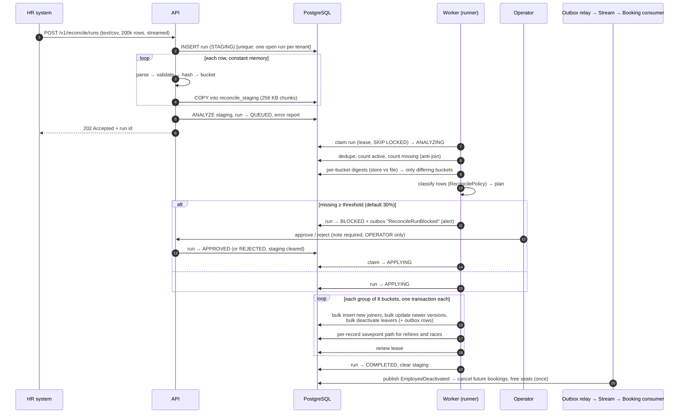

# RosterSync: design note

**Problem.** A client's HR system pushes employee changes (joins, transfers, shift changes, exits) through an API in near real time, and sends a full export of up to 200,000 employees every night. Messages arrive twice, out of order, with bad data, and sometimes cut short. Some fields belong to HR, others to the transport admin. MoveInSync's roster must stay correct regardless, and every applied change must reach downstream systems (cab bookings) exactly once in effect.

## 1. Architecture

- **Backend** (Spring Boot, stateless): authenticates (Spring Security, JWT or API key), validates at the boundary, applies live events, streams nightly uploads into staging with PostgreSQL `COPY`. Domain rules live in plain Java classes with no Spring or database imports (`com.rostersync.domain`), unit-tested on their own. Flyway creates the schema at startup.
- **Background loops** (`@Scheduled`, same app): the outbox relay (DB to stream), the nightly runner (analyzes and applies runs under a lease), and the deactivation consumer (cancels bookings for leavers).
- **PostgreSQL** is the source of truth. The tenant comes from the credential and every query filters by `tenant_id`.
- **Redis** has two roles: a cache that can be lost (TTL plus `volatile-lru`), and the event stream (no TTL, appendonly).

## 2. Data model (key tables)

| Table | Purpose | Notes |
| --- | --- | --- |
| `employees` | One row per (tenant, employee) | HR columns, transport columns, `status`, `hr_version` (high-water mark), `transport_version` (optimistic lock), `hr_hash` (128-bit content hash), `bucket` (0–255) |
| `outbox` | Change events, written in the business transaction | `PENDING → SENT` or `DEAD`; partial index on pending rows |
| `consumed_events` | Consumer-side idempotency | PK (consumer, event_id) |
| `reconcile_runs` | One nightly file | State machine below; unique partial index allows one open run per tenant |
| `reconcile_staging` | Streamed file rows | COPY target, indexed by (run, bucket, id) |
| `ingest_batches`, `ingest_errors` | Error reports | Codes and field names only, never values |
| `trips`, `bookings` | Downstream side effects | Seat count checked `0 ≤ booked ≤ capacity` |
| `sign_in_codes` | Employee one-time sign-in codes | HMAC of the code only; expiry, attempt count, single use. Employees need no login account |

**Idempotency key** = `(tenant_id, employee_id, source_version)`. Versions are monotonic per employee, so `hr_version` is a high-water mark: incoming `>` stored means apply, `=` means duplicate (a no-op, flagged as a conflict if the content differs), `<` means stale (ignored). There is no unbounded "processed ids" table, and the check runs on the row we lock anyway.

**Field ownership.** HR owns name, email, phone, manager, office and shift. The transport admin owns pickup point and special assistance. The two writers update disjoint columns (`saveHr` / `saveTransport`), so neither can overwrite the other even when they race. HR fields sent by the transport admin, or transport fields sent by HR, are dropped with a warning instead of rejected. An HR exit changes `status`; transport values are kept for a possible rehire.

**Nightly run states:** `STAGING → QUEUED → ANALYZING → (BLOCKED → APPROVED | REJECTED) → APPLYING → COMPLETED`, or `FAILED`.

**Main APIs** (full list in the README):

| Endpoint | Caller | Purpose |
| --- | --- | --- |
| `POST /v1/events` | HR system (API key) | 1–5,000 create/update/deactivate events; per-record result |
| `POST /v1/reconcile/runs` | HR system | Nightly CSV, streamed; `202` with the run id |
| `POST /v1/reconcile/runs/{id}/approve` · `/reject` | Operator | Decide a run paused by the safety brake (note required) |
| `PATCH /v1/employees/{id}/transport` | Transport admin | Pickup point / special assistance, with optimistic version |
| `GET /v1/batches/{id}/errors` | Operator, admin | Per-record error report (codes and fields, no values) |
| `GET /v1/me` | Employee | Own profile and upcoming rides |

## 3. Hardest flow: nightly reconciliation with the safety brake

Why it is safe:
- **Bounded memory:** the file is never held in memory, and the diff runs in Postgres. Measured on 200k rows: 28.8 s end to end; JVM heap in use peaked at 164 MB, mostly short-lived garbage between collections. The rows themselves are never held in a collection.
- **Resumable:** each bucket group commits on its own. After a crash the lease expires, another worker claims the run, and groups that already committed now compare equal, so nothing is applied twice (tested by killing the process mid-apply).
- **Never undoes newer live data:** set-based updates require `file.version > stored.version` under a row lock, so a live update that lands during the run wins (tested with live events racing a run).

## 4. Failure modes

| What fails | What the user sees | How the system recovers |
| --- | --- | --- |
| Same event delivered twice, or a whole feed replayed | Result `DUPLICATE`/`STALE`; nothing changes | Version high-water mark; a replayed feed is a no-op (tested) |
| Events out of order (v7 before v6) | v6 reported `STALE`; employee shows v7 state | Version comparison per employee under a row lock |
| Bad record in a batch | That record is `REJECTED` with a code and field; the rest apply | Validation per record, one transaction per record |
| Exit arrives before the join | Join reported `STALE` | Tombstone row stores the exit's version |
| Nightly file truncated or filtered upstream | Run `BLOCKED` ("missing 80,000 of 200,000"); nobody deactivated | Safety brake; operator approves or rejects with a note; alert fires |
| File missing columns or unreadable | 400 with the missing columns; run `FAILED` | Slot freed immediately for a corrected file |
| Upload abandoned mid-stream | Run stays `STAGING` until the lease expires, then `FAILED` | Abandoned-upload sweeper in the worker (`ReconcileRepository.failAbandonedUploads`) |
| A dependency hangs (timeout) | A slow response, never a hung one | Redis commands time out after 2 s and fail fast; a DB connection wait times out and is retried as transient; a stuck nightly worker loses its lease and another resumes; clients retry safely because every write is idempotent |
| Process crash between employee write and event | Client gets no response and retries | Single transaction rolls back both; the retry applies once (tested with kill) |
| Relay crash after publish, before mark-sent | Nothing visible | Republished at least once; consumer dedupes by event id (tested) |
| Redis (stream) down | Changes still saved; events delayed; "Catching up" on dashboard | Relay stops the batch without burning attempts; lag/depth alerts; drains on recovery |
| Redis (cache) down | Slightly slower reads | Cache errors count as misses; never fail a request (tested) |
| Message impossible to publish | "Needs attention" count on dashboard | Retried with backoff, then dead-lettered |
| Consumer crashes before ACK | Booking cancellation delayed by about 30 s | `XPENDING` + `XCLAIM` hand the message to a live consumer (tested) |
| Worker crashes mid-run | Run stays `APPLYING` briefly | Lease expires; another worker resumes (tested) |
| Two uploads at once | Second gets 409 "already in progress" | Unique partial index (tested) |
| HR and transport edits race | Both changes kept | Disjoint columns; transport uses optimistic version (409 on a stale edit) |
| Postgres down | 503 from `/health/ready`; API returns errors with a request id | Pool reconnects; HR retries; no partial writes exist |

## 5. Consistency, availability, latency

- **Strong consistency** for the roster: every write is one ACID transaction on one row lock. Two employees never block each other.
- **Eventual consistency** downstream: events are at-least-once, with exactly-once effect through consumer idempotency. Lag is measured (`rostersync_outbox_lag_seconds`) and alerted at 2 minutes.
- **Availability over latency** for dependencies other than Postgres: Redis outages slow things down but never reject writes. Postgres is the one hard dependency.
- **Nightly safety over freshness:** a suspicious file waits for a human rather than applying partially.
